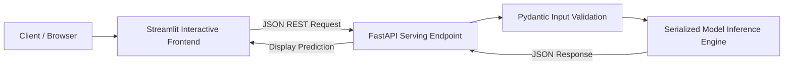

# Full-Stack Machine Learning Serving Framework

> Production-grade model serving architecture pairing FastAPI REST APIs with an interactive Streamlit UI.

[](https://github.com/sohailahmed-bsrh/fullstack-ai-serving-framework)
[](https://sohail.devsil.com/projects.html)
[](https://sohail.devsil.com)

---

## Overview

Trained machine learning models remain inert without robust API serving infrastructure and user-accessible interfaces.

This project provides an end-to-end, reproducible implementation engineered to solve this challenge through verified data transformations, robust algorithms, and production-ready architecture.

---

## Key Features

- FastAPI RESTful endpoint serving serialized Scikit-learn model predictions
- Input payload validation and strict type guarantees using Pydantic schemas
- Streamlit interactive dashboard communicating with model server via HTTP JSON requests
- Dual-backend comparison benchmarking FastAPI throughput against synchronous Flask

---

## System Architecture



---

## Technology Stack

| Technology | Version / Spec | Role in Architecture |
| :--- | :--- | :--- |
| **FastAPI** | `0.104+` | High-throughput asynchronous model serving endpoints |
| **Pydantic** | `2.0+` | Request payload validation and schema enforcement |
| **Streamlit** | `1.28+` | Interactive parameter entry and visual inference output |
| **Flask** | `3.0+` | Alternative synchronous backend implementation |
| **Scikit-learn** | `1.3+` | Model training, serialization, and pipeline loading |

---

## Repository Structure

```text
fullstack-ai-serving-framework/
|-- notebooks/
|   `-- FULL_STACK_AI_APPLICATION_DEVELOPMENT_USING_STREAMLIT,_FLASK_AND_FASTAPI.ipynb
|-- src/
|-- .gitignore
|-- requirements.txt
`-- README.md
```

---

## Installation and Execution

### Prerequisites
- Python 3.10 or higher
- Git version control
- Virtual environment manager (`venv`)

### Setup Instructions
1. Clone the repository:
```bash
git clone https://github.com/sohailahmed-bsrh/fullstack-ai-serving-framework.git
cd fullstack-ai-serving-framework
```

2. Configure environment and dependencies:
```bash
python -m venv venv
source venv/bin/activate  # On Windows: venv\Scripts\activate
pip install -r requirements.txt
jupyter notebook notebooks/
```

---

## Interface and Verification
The system produces verifiable execution logs, prediction matrices, or interactive browser interfaces depending on the target mode. Verify operation by executing the commands specified above or inspecting the demonstration notebooks.

---

## Author and Contact
Developed by **Sohail Ahmed** — Full Stack AI Engineer & Machine Learning Specialist.
- **Portfolio:** [sohail.devsil.com](https://sohail.devsil.com)
- **GitHub:** [@sohailahmed-bsrh](https://github.com/sohailahmed-bsrh)
- **Email:** [sohail.bsrh@gmail.com](mailto:sohail.bsrh@gmail.com)
